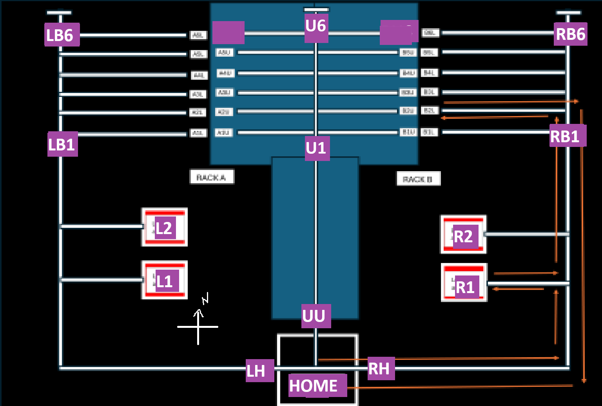

# AGV Software Documentation

**Part IB Integrated Design Project — M1 2026**
Repository: `wyt33jasper/PartIB-Integrated-Design-Project` · firmware in [`sw/`](sw)

This document is the software half of the technical documentation the task
sheet asks for:

> Software should be well-structured and well-commented, such that another
> engineer might easily debug/modify/replicate the code. The main code should
> be no more than 2 sides of A4 if possible, plus required modules/classes.
> The code and an algorithm flowchart are required to be submitted.

It is written so that an engineer who has never seen the robot can read it,
flash the Pico, understand every decision the AGV makes, change a tuned
number in the right place, and find the test that proves the change works.

---

## Contents

1. [What the AGV does](#1-what-the-agv-does)
2. [Repository layout](#2-repository-layout)
3. [Getting the code onto the robot](#3-getting-the-code-onto-the-robot)
4. [Hardware interface and pin map](#4-hardware-interface-and-pin-map)
5. [Architecture](#5-architecture)
6. [Algorithm flowchart](#6-algorithm-flowchart)
7. [Walkthrough of `main.py`](#7-walkthrough-of-mainpy)
8. [Module and function reference](#8-module-and-function-reference)
9. [The map and the navigation model](#9-the-map-and-the-navigation-model)
10. [Configuration reference](#10-configuration-reference)
11. [Testing](#11-testing)
12. [Design decisions and their reasons](#12-design-decisions-and-their-reasons)
13. [Known gaps and work still to do](#13-known-gaps-and-work-still-to-do)

---

## 1. What the AGV does

One run, in one paragraph: the AGV waits in the start box for a button press,
drives to a loading bay, closes its gripper on the package there and reads the
package's magnet pole with a pair of Hall sensors, lights red for north and
green for south, works out from the pole and the collection side which rack and
which deck the package belongs on, drives the corridor serving that shelf,
measures each bay with a side-facing time-of-flight sensor as it passes, turns
into the first bay the sensor reports as empty, releases the package, reverses
back out, and then either starts another package or drives home — whichever the
clock allows. An amber beacon flashes the whole time it is live, and the button
stops it at any point.

### Task requirements, and where each one is met

| Requirement (task sheet) | Where it is implemented |
|---|---|
| Easily accessible start/stop button | [`drivers/button.py`](sw/drivers/button.py), latched on a pin IRQ; checked every loop pass in `main.run()` |
| Flashing amber light when in operation | [`drivers/indicators.py`](sw/drivers/indicators.py) `FlashingLamp`, 2 Hz, driven from `Robot.service()` |
| Steady red for north pole, green for south | `PoleIndicator` in [`drivers/indicators.py`](sw/drivers/indicators.py) |
| Recognise packages by magnetic field | [`drivers/magnet.py`](sw/drivers/magnet.py) — two unipolar Hall sensors, reading confirmed 3× before it is believed |
| Only deliver if the location is not already occupied | [`drivers/rangefinder.py`](sw/drivers/rangefinder.py) + `Mission.bay_beside()` in [`nav/mission.py`](sw/nav/mission.py) |
| Left areas → rack A, right → rack B; north → top, south → bottom | [`nav/destination.py`](sw/nav/destination.py) — that rule and nothing else |
| Deal with four tables that are similar but not identical | Topological navigation: junctions are counted, distances are never measured ([`nav/junction.py`](sw/nav/junction.py), [`nav/map.py`](sw/nav/map.py)) |
| Deliver as many as possible in 5 minutes | `Mission.time_short` — a measured, self-correcting time reserve |
| Return to the start box (+15, needs ≥2 delivered) | `TO_HOME` phase, `config.HOME_NODE` |
| LEDs not driven directly from the Pico | Hardware: opto-isolator / transistor stage on the interface board. The software only ever drives a GPIO. |
| Stop at red traffic lights, wait for green IR (+10/pallet) | **Not implemented** — see [§13](#13-known-gaps-and-work-still-to-do) |

---

## 2. Repository layout

```
agv/
├── sw/                      <- everything that runs on the Pico
│   ├── main.py              the program; runs automatically at power-up
│   ├── config.py            every pin number and every tuned constant
│   ├── drivers/             hardware. Knows about pins, knows nothing about the task
│   │   ├── button.py          debounced, IRQ-latched start/stop button
│   │   ├── motor.py           one TB6612FNG channel
│   │   ├── drive.py           the two drive motors as one differential drive
│   │   ├── gripper.py         linear actuator, driven on a deadline not a sleep
│   │   ├── indicators.py      amber beacon and the red/green pole lamps
│   │   ├── line_sensor.py     the four reflective sensors
│   │   ├── magnet.py          Hall sensors -> "north" / "south"
│   │   └── rangefinder.py     the two side ToF sensors -> "bay occupied?"
│   ├── nav/                 navigation. Knows about the task, touches no pins
│   │   ├── follower.py        line following, one correction per tick
│   │   ├── junction.py        tracker readings -> one event per junction
│   │   ├── map.py             the table as a graph, plus breadth-first routing
│   │   ├── navigator.py       where the AGV is and which way it faces
│   │   ├── destination.py     the pole/side rule from the task spec
│   │   └── mission.py         the plan: what to do next, and why
│   ├── libs/                third-party drivers, unmodified (VL53L0X, TMF8x01, ...)
│   └── test_*.py            bench tests, run on the robot from Thonny
├── tools/                   host-side checks; run on a PC, never uploaded
│   ├── picostub/              fake machine/utime so sw/ imports on a desktop
│   ├── simulate.py            drives the real follower round a virtual track
│   ├── simulate_run.py        boots the real main.py and drives a whole run
│   ├── tune.py                sweeps FOLLOW_SPEED / FOLLOW_STEER
│   └── test_*.py              map, mission, config, magnet and ranger checks
├── docs/
│   ├── navigation.md          why the navigation is designed the way it is
│   └── map-survey.md          blank survey sheet to fill in at the table
├── support/                 QR code generator (kept for reference; see §12)
├── idp_map.png              the table, with the node names used in map.py
└── DOCUMENTATION.md         this document
```

The split that matters is **`drivers/` vs `nav/`**. A driver may import
`machine`; a navigation module may not. That is what lets the whole mission run
on a laptop with no robot attached, which is how most of it was debugged.

---

## 3. Getting the code onto the robot

1. Open Thonny and connect to the Pico (bottom right of the window).
2. Copy the **contents of `sw/`** to the Pico's root: `main.py`, `config.py`,
   and the `drivers/`, `nav/` and `libs/` folders. Keeping the folder structure
   matters — the imports are `from drivers.button import Button`.
3. The file must be called `main.py` on the Pico. MicroPython runs `main.py`
   automatically at power-up, which is why the program waits for a deliberate
   button press before it moves anything.
4. To run it with the console attached, press Run in Thonny. `Ctrl-C` stops it;
   the `finally:` block in `main()` cuts the motors on the way out.

Do **not** copy `tools/` to the Pico. `tools/picostub/` contains fake `machine`
and `utime` modules that would shadow the real ones.

### Checklist before the first powered test

```bash
python3 tools/test_config.py        # pins, limits, and every tuned number
python3 tools/test_map.py           # the map is consistent, every route exists
python3 tools/test_mission.py       # the planner, against the real map
python3 tools/simulate_run.py       # boots sw/main.py and drives a whole run
```

Then, on the robot, with the motors unplugged:
`test_line_sensors.py`, `test_stop_button.py`, `test_magnet.py`,
`test_rangefinder.py`. See [§11](#11-testing).

---

## 4. Hardware interface and pin map

Pin numbers are **GPxx numbers** (`machine.Pin`), not the jumper header numbers
printed on the PicoBot. All of them live in [`config.py`](sw/config.py) and
nowhere else; `tools/test_config.py` fails if any pin is claimed twice, and
`tools/simulate_run.py` prints the allocation as `main()` actually built it.

| GP | Function | Config constant |
|---|---|---|
| 0, 1 | Gripper linear actuator — dir, PWM (Motor Driv1 #1, 6V5) | `GRIPPER_DIR_PIN`, `GRIPPER_PWM_PIN` |
| 4, 5 | Left drive motor — dir, PWM (Motor Driv2 #1, 12 V) | `LEFT_MOTOR_DIR_PIN`, `LEFT_MOTOR_PWM_PIN` |
| 6, 7 | Right drive motor — PWM, dir (Motor Driv2 #2, 12 V) | `RIGHT_MOTOR_PWM_PIN`, `RIGHT_MOTOR_DIR_PIN` |
| 10, 11 | I2C1 — right-hand rangefinder (SDA, SCL) | `RANGER_PINS["right"]` |
| 12 | Hall sensor, north-facing | `MAGNET_NORTH_PIN` |
| 14 | Hall sensor, south-facing | `MAGNET_SOUTH_PIN` |
| 16, 17 | I2C0 — left-hand rangefinder (SDA, SCL) | `RANGER_PINS["left"]` |
| 18, 19 | Inner line trackers — left, right | `LINE_TRACKER_L_PIN`, `LINE_TRACKER_R_PIN` |
| 20 | Start/stop button | `BUTTON_PIN` |
| 21, 22 | Pole lamps — red (north), green (south) | `RED_LED_PIN`, `GREEN_LED_PIN` |
| 26 | Amber beacon | `AMBER_LED_PIN` |
| 27, 28 | Outer turn trackers — left, right | `TURN_TRACKER_L_PIN`, `TURN_TRACKER_R_PIN` |

Free: GP2, GP3, GP9, GP13, GP15 (servo channel 2 / channel 1), GP8.

Two constraints are worth knowing before moving anything:

- **No ADC pin is free.** The Pico's three ADC pins are GP26, GP27 and GP28,
  and M1 put the beacon and the two turn trackers on them. That is why the
  magnet pole is read with a *digital* Hall pair rather than a ratiometric
  sensor; `AnalogueHall` is written and tested but unusable until a turn
  tracker is moved to a plain GPIO.
- **Two VL53L0Xs both answer at `0x29`**, so they cannot share one I2C bus
  without XSHUT sequencing at boot. They are on separate buses instead. A
  VL53L0X (`0x29`) and a TMF8x01 (`0x41`) would share a bus happily and would
  free GP10/GP11.

**Electrical:** every sensor and every LED is isolated from the Pico through
the interface board's opto-isolator / transistor stage, as the build spec
requires. The software never assumes anything about that stage except its
logic polarity, which is configurable (`*_ACTIVE_HIGH`, `LINE_WHITE_IS_HIGH`)
precisely so a board built the other way round needs no code change. Every
input pin is pulled to its **inactive** level, so a disconnected or broken
sensor reads as "nothing there" rather than floating.

---

## 5. Architecture

```
                         main.py
            the loop: reads events, carries out instructions
                   makes no route decisions of its own
                              |
        +---------------------+---------------------+
        |                                           |
     drivers/                                     nav/
  owns the hardware                          owns the plan
  imports machine                        imports no hardware
        |                                           |
  Button   Drive/Motor                      LineFollower
  Gripper  FlashingLamp                     JunctionDetector
  LineSensorArray                           State (navigator)
  MagnetSensor                              Mission
  BayScanner                                map / destination
```

Three rules hold the design together. All three were written in response to
something that actually went wrong during M1, and all three are enforced by a
test.

**1. Nothing inside the loop blocks.** Every call in the main loop returns
immediately. The gripper movements and the three turn phases are *deadlines
checked inside the loop*, not `sleep()`s. During M1 the turns were fixed
sleeps, which left the stop button unread for up to 4.4 seconds at a time —
unacceptable on a safety control. The motion is identical; the button and the
beacon are now serviced every few milliseconds throughout. The same reasoning
produced `VL53L0XDevice`, because the supplied VL53L0X library's `read()` spins
for up to a second waiting for a measurement.

**2. The motors are stopped on every exit path.** `main()` wraps `run()` in
`try/finally`, so a normal stop, a `Ctrl-C` from Thonny and an unhandled
exception inside the loop all end with the drive cut, the gripper cut and the
lamps dark. A software fault cannot leave the AGV driving.

**3. Every tuned number lives in `config.py`, and only there.** No constructor
in `sw/` defaults a numeric parameter. This is not tidiness: the follower used
to default to speed 60 / steer 40 while `config.py` said 50 / 20, and
`Drive.ROTATE_SCALE` was measured on the table and then buried in a driver
where nobody tuning the robot would look. `tools/test_config.py` fails the
build if a numeric default reappears, or if a constant in `config.py` is never
read by anything.

### Where state lives

| State | Owner | Notes |
|---|---|---|
| Where the AGV is on the map, and its heading | `nav.navigator.State` | Records what the AGV was *told* to do; watches no sensors |
| Which phase of the job it is in, and the target | `nav.mission.Mission` | The only thing that decides where to go next |
| Whether a junction is currently being counted | `nav.junction.JunctionDetector` | A three-state machine, one event per physical junction |
| The last few bay-occupancy samples | `drivers.rangefinder.BayScanner` | A rolling window per side |
| Whether a pole has been confirmed | `drivers.magnet.MagnetSensor` | Needs `MAGNET_CONFIRM_READS` identical reads |
| Whether the button has been pressed | `drivers.button.Button` | Set by a pin interrupt, cleared by the reader |

---

## 6. Algorithm flowchart

The flowchart below is the one the task sheet asks to be submitted. It is the
same diagram that appears at the top of `main.py`, so the code and the drawing
cannot drift apart.

```mermaid
flowchart TD
    PWR([Pico powered up: main.py runs]) --> BUILD[build&#40;&#41;: construct drivers,<br/>navigation and mission from config.py]
    BUILD --> WAIT[/Wait for start button press/]
    WAIT --> BEACON[Amber beacon on<br/>Plan first leg, turn on the spot]
    BEACON --> LOOP{{main loop}}

    LOOP --> STOP{Stop button<br/>pressed?}
    STOP -- yes --> END([Cut motors, gripper,<br/>beacon and lamps])
    STOP -- no --> SERVICE[service&#40;&#41;: beacon, gripper,<br/>rangefinders, Hall pair,<br/>clock, pole lamps]

    SERVICE --> BAY{Line run out,<br/>and in a bay?}
    BAY -- yes --> JOB{Which job?}
    JOB -- pick up --> GRIP[Close gripper,<br/>confirm the pole]
    JOB -- put down --> REL[Open gripper]
    GRIP --> OUT[Reverse out of the bay]
    REL --> OUT
    OUT --> NEXTLEG[Ask the mission for the next turn]
    NEXTLEG --> TURN
    BAY -- no --> FREE{Rangefinder reports<br/>a free bay beside us?}

    FREE -- yes --> TURN[Perform turn:<br/>drive over, commit, seek line]
    FREE -- no --> JUNC{Junction<br/>detected?}
    JUNC -- yes --> ASK[Ask the mission for the turn]
    ASK --> DONE{Run over?}
    DONE -- yes --> END
    DONE -- no --> TURN
    TURN --> LOOP
    JUNC -- no --> FOLLOW[One line-following correction]
    FOLLOW --> LOOP
```



Plain-text version, for printing:

```
Main --> [stop button pressed?] --yes--> End
                 | no
                 v
          Flash amber LED
                 v
     [line run out in a bay?] --yes--> grip or release, back out, turn
                 | no
                 v
     [free bay beside us?] --yes--> turn into it
                 | no
                 v
        [junction detected?] --yes--> ask the mission for the turn
                 | no
                 v
           Line follower
                 |
                 +--------> back to the stop check
```

---

## 7. Walkthrough of `main.py`

[`sw/main.py`](sw/main.py) is 440 lines, of which 254 are code and the rest
are the comments that explain it. Its *executable* content is small: one class
of eleven attributes, five short helpers, a 75-line loop, and a constructor.
It makes no route decisions at all — it runs the hardware, reports two kinds of
event, and carries out whatever the mission asks for in reply.

This section walks the whole file in execution order.

### 7.1 Power-up → `main()` (line 421)

MicroPython runs `main.py` automatically when the Pico is powered, so the file
must not move anything on import. It does not: `main()` is called only from the
`if __name__ == "__main__":` guard at the bottom, and the first thing it does
after building the robot is *wait*.

```python
def main():
    robot = build()
    print("AGV ready - press the button to start")
    robot.button.wait_for_press()
    try:
        run(robot)
    finally:
        robot.drive.stop()
        robot.gripper.stop()
        robot.beacon.off()
        robot.poles.off()
        print("AGV stopped")
```

`wait_for_press()` is the one place in the program where blocking is correct
and in fact wanted — the AGV must sit still until an operator starts it. It
waits for the press, then waits out the *release*, so the same press cannot
immediately be read again as the stop command.

The `finally:` block is rule 2 from [§5](#5-architecture). It runs on a normal
stop, on `Ctrl-C` from Thonny, and on any unhandled exception raised anywhere
inside the loop.

### 7.2 `build()` (line 362) — constructing the robot from `config.py`

`build()` is the only place in the program that reads `config.py`. Everything
else is handed what it needs through its constructor, which is what lets each
piece be tested on its own.

It constructs, in order:

| Object | From | Notes |
|---|---|---|
| `Button` | `BUTTON_PIN`, `BUTTON_ACTIVE_HIGH`, `BUTTON_DEBOUNCE_MS` | Attaches the pin interrupt |
| `FlashingLamp` (beacon) | `AMBER_LED_PIN`, `AMBER_FLASH_MS` | Starts dark |
| `Drive` | the four motor pins, `MOTOR_PWM_FREQ_HZ`, `TURN_ROTATE_SCALE` | Builds two `Motor`s, right one reversed |
| `LineSensorArray` | the four tracker pins, `LINE_WHITE_IS_HIGH` | Outer pair passed as `None` if `TURN_TRACKERS_FITTED` is False |
| `LineFollower` | `FOLLOW_SPEED`, `FOLLOW_STEER`, `RECOVER_SPEED`, `LOST_TIMEOUT_MS` | Every value required, none defaulted |
| `JunctionDetector` | `JUNCTION_CONFIRM_MS`, `JUNCTION_CLEAR_MS` | Shares the one `LineSensorArray` |
| `PoleIndicator` | `RED_LED_PIN`, `GREEN_LED_PIN` | |
| `MagnetSensor` | `probe_from_config()`, `MAGNET_POLL_MS`, `MAGNET_CONFIRM_READS` | Probe is digital or analogue per `MAGNET_MODE` |
| `BayScanner` | `scanner_from_config()` | Falls back to `NullRanger` per side if a sensor does not answer |
| gripper | `gripper_from_config()` | `NullGripper` when `GRIPPER_FITTED` is False |
| `State` | `INITIAL_NODE`, `INITIAL_DIRECTION` | Raises immediately on an unknown node or heading |
| `Mission` | `PICKUP_ORDER`, `HOME_NODE`, `RUN_LIMIT_MS`, `CYCLE_RESERVE_MS`, `BAY_UNKNOWN_IS_OCCUPIED` | |

It then prints the scan geometry it actually built —

```
bay scan: 5 samples every 50 ms, so a verdict looks back 250 ms
```

— and warns loudly if the rangefinders or the gripper are missing, saying what
the AGV will do instead. A missing sensor does not stop the robot booting; it
degrades it in a way the operator can see.

Finally it returns a `Robot`: a plain container for the eleven objects, so that
every helper in the file can take one argument. Its one method is the important
one:

```python
def service(self):
    """One pass of everything that has to keep running. Never blocks."""
    self.beacon.update()      # toggle the amber lamp if its interval elapsed
    self.gripper.update()     # cut the actuator if its movement deadline passed
    self.scanner.poll()       # sample both side rangefinders if due
    self.magnet.poll()        # sample the Hall pair if due
    self.mission.tick()       # note the time
    self.poles.show(self.mission.carrying or self.magnet.pole)
```

That last line is the pole display rule. The lamp shows the package being
**carried**, which stays lit for the whole delivery, and falls back to the
**live** Hall reading while a package is being picked up — so the judges watch
the identification happen. Both lamps go dark the moment the package is put
down, which keeps the display honest: a lamp left lit from the previous package
would claim an identification that has not been made.

`service()` is called from every wait in the file. Whatever the AGV is doing —
turning, gripping, reversing — these five things keep running.

### 7.3 `run()` (line 284) — the loop

```python
robot.beacon.on()
turn = robot.mission.start()
if turn is not None and not _perform_turn(robot, turn):
    return
robot.junctions.pause()
```

Two things happen before the loop begins.

**The first instruction is a turn where the AGV stands.** It may be parked
facing away from its first destination, and there is no junction to wait for
before setting off, so `Mission.start()` returns a turn to make on the spot.

**`junctions.pause()`** requires a clear window before anything counts as a
junction. Leaving the start box drags the outer trackers over whatever marking
the start node has, and without this that would be counted as the first
junction — which would put the entire route one junction out of step.

Then the loop. Each pass tests four things in this order, and the order is the
design:

#### a. Stop button (line 303)

```python
if robot.button.was_pressed():
    return
```

First, before anything else, every pass. The press was latched by a pin
interrupt the instant it happened, so the loop cannot miss one even if it was
busy; this just reads and clears the latch. Returning falls into `main()`'s
`finally:`, which cuts everything.

#### b. Service everything (line 307)

`robot.service()`, as above.

#### c. Has the line run out in a bay? (line 313)

```python
line_l, line_r = robot.sensors.line_trackers()
if not line_l and not line_r and robot.mission.expecting_bay:
```

Both inner trackers reading black normally means the AGV has strayed off the
line, and the follower should recover. In a bay it means **arrival**: a bay is
a spur with nothing past it, so the line simply stops there.

`mission.expecting_bay` is what tells the two cases apart, and it is stricter
than "we are heading for a bay". It requires that the AGV is standing at the
bay's own corridor junction *and facing into the spur*. Without that, a stray
loss of line anywhere on the long drive to a loading bay would be read as
having arrived at it.

On arrival the sequence is: stop → `_handle_bay()` → `_reverse_out_of_bay()` →
ask the mission for the next turn → perform it → `continue`.

#### d. Is there a free bay beside us? (line 333)

```python
turn = robot.mission.bay_beside()
if turn is not None:
    ...
    _perform_turn(robot, turn)
    continue
```

This is the delivery leg, and it is asked **every pass**, not at any particular
place, because the side rangefinders look out of the chassis continuously. The
AGV drives past the full bays without ever stopping and turns into the first
free one the moment the sensor reports it. `Mission.bay_beside()` returns
`None` unless the mission is in its `SCAN` phase, standing beside a bay, and
the rangefinder on the side that bay is on reports it empty.

#### e. Junction? (line 342)

```python
signature = robot.junctions.poll()
if signature != NONE:
    turn = robot.mission.at_junction()
    if turn is None:
        robot.drive.stop()
        print("Run complete: {}".format(robot.mission.report()))
        return
    ...
```

`poll()` returns exactly one signature per physical junction — `left`, `right`
or `crossroads` — and `NONE` the rest of the time. The mission answers with a
turn, or with `None` to mean the run is over. The signature itself is used only
for the log; the route comes from the map.

#### f. Otherwise, follow the line (line 357)

```python
robot.follower.tick()
sleep_ms(config.LOOP_PERIOD_MS)
```

One steering correction, then straight back to the stop-button check. The
`sleep_ms(5)` is the only sleep in the loop and sets the loop period; at 5 ms
the button is tested two hundred times a second.

### 7.4 `_perform_turn()` (line 113) — rotating onto the next line

A turn has three phases, with the durations measured on the table during M1:

| Phase | Until | What it does |
|---|---|---|
| **drive over** | `TURN_DRIVE_OVER_MS` (1200 ms) | Drives forward, to carry the wheels past the junction so the AGV pivots *beyond* the marking rather than on top of it |
| **commit** | `+ TURN_COMMIT_MS` (300 ms) | Rotates without checking the trackers, so they clear the line being left. Without this the turn "finishes" instantly on a line it has not left yet |
| **seek** | until the line is reacquired | Keeps rotating; accepts the new line only once `has_left_line` is true and both inner trackers read white |

`straight` returns immediately — there is nothing to do. `uturn` uses its own,
longer phase times (`UTURN_DRIVE_OVER_MS`, `UTURN_COMMIT_MS`) and
`Drive.u_turn()` rather than `Drive.rotate()`.

Three details are worth knowing when debugging a turn:

- `robot.junctions.pause()` is called at the start *and* again on success. The
  outer trackers sweep across lines throughout a turn; suspending detection
  means none of that is counted, and requiring a clear window afterwards means
  the junction just turned at cannot be counted a second time on the way out.
- The loop body is `button → service() → check deadlines → drive → sleep`, so
  the stop button and the beacon are live for the whole of a turn that may take
  several seconds.
- If the line never appears within `TURN_TIMEOUT_MS` (6 s) it stops the motors
  and raises `RuntimeError`. That propagates to `main()`'s `finally:`, which
  cuts everything — a failed turn stops the AGV rather than letting it spin.

### 7.5 `_wait()` (line 94) — the shape of every other wait

```python
def _wait(robot, until, timeout_ms=0):
    while True:
        if robot.button.was_pressed():
            robot.drive.stop()
            return False
        robot.service()
        if until():
            return True
        if timeout_ms and ticks_diff(ticks_ms(), started_ms) >= timeout_ms:
            return None
        sleep_ms(config.LOOP_PERIOD_MS)
```

Three outcomes, deliberately distinguishable: `True` the condition came true,
`False` the stop button was pressed, `None` it timed out. Every caller checks
for `False` and returns, which is how a stop press propagates out of a nested
wait and into `main()`'s `finally:`.

### 7.6 `_collect()`, `_release()`, `_handle_bay()` (lines 216–281)

`_collect()` resets the magnet sensor, starts the gripper closing, and waits
for **both** "a pole has been confirmed" and "the gripper has finished moving".

The Hall pair does double duty here, which is the reason there is no separate
approach sensor: neither sensor reads high until the magnet is in range, so
*"a pole is readable"* and *"the package is close enough to grip"* are the same
signal.

If `COLLECT_TIMEOUT_MS` (4 s) passes with no pole, it returns `(True, None)`.
That means the loading bay was empty or the magnet never confirmed — both have
the same consequence for the plan, so both are reported the same way. The AGV
then *releases* rather than carrying the mechanism around closed on thin air,
and moves on to the next pickup.

`_handle_bay()` asks `mission.at_bay()` what the bay is for and does it:
`PICK_UP` → collect and report the pole; `PUT_DOWN` → release and report the
drop; anything else is an unexpected dead end, which is logged and ends the
run.

### 7.7 `_reverse_out_of_bay()` (line 196)

A bay is a dead end, so there is no line to follow back out. The AGV reverses
for `BAY_REVERSE_MS` (3 s, measured on the table) until it is far enough along
the spur to turn. It is written as a `_wait()` whose predicate also does the
driving, so the stop button stays live throughout.

### 7.8 What the console shows during a run

`simulate_run.py` produces exactly what the Pico prints. An abridged run:

```
bay scan: 5 samples every 50 ms, so a verdict looks back 250 ms
AGV ready - press the button to start
to pickup -> R1_BAY (at HOME facing E, carrying nothing, 0 delivered, 0s elapsed, 90s reserved)
crossroads at RC -> left
crossroads at R1 -> left
  collecting at R1_BAY
  identified north pole
to shelf -> U6 (at R1 facing S, carrying north, 0 delivered, 18s elapsed, 90s reserved)
crossroads at HOME -> right
crossroads at U1 -> straight
crossroads at U2 -> straight
crossroads at U3 -> straight
free bay beside us at U3 -> right
  delivering at RU3_BAY
to pickup -> R2_BAY (at U3 facing S, carrying nothing, 1 delivered, 48s elapsed, 90s reserved)
...
Run complete: finished -> None (at HOME facing E, carrying nothing, 4 delivered, 205s elapsed, 90s reserved)
AGV stopped
```

Note `U1` and `U2` being driven straight over after the sensor reported them
full, and the turn into `RU3_BAY` coming from the *rangefinder* rather than
from the junction count.

---

## 8. Module and function reference

Every function in `sw/` (excluding `libs/`, which is third-party and
unmodified) and in `tools/`. Methods prefixed with `_` are internal to their
class; they are listed because a maintainer reading the code will meet them.

### 8.1 `main.py`

| Function | Explanation |
|---|---|
| `class Robot` | A container for the eleven objects the loop touches, so every helper takes one argument. |
| `Robot.__init__(button, beacon, drive, sensors, follower, junctions, poles, magnet, scanner, gripper, mission)` | Stores them. No logic. |
| `Robot.service()` | One pass of everything that has to keep running: beacon, gripper deadline, both rangefinders, the Hall pair, the mission clock, and the pole lamps. Never blocks. Called from every wait in the file. |
| `_wait(robot, until, timeout_ms=0)` | Services the robot until `until()` is true. Returns `True` on success, `False` if the stop button was pressed, `None` on timeout. The shape of every wait outside the main loop. |
| `_perform_turn(robot, turn)` | Rotates off the current line onto the next: drive over, commit, seek. Returns `True` on success, `False` on a stop press; raises `RuntimeError` if the line never appears within `TURN_TIMEOUT_MS`. `straight` is a no-op. |
| `_reverse_out_of_bay(robot)` | Reverses for `BAY_REVERSE_MS` to back out of a dead-end bay, where there is no line to follow. Returns `False` on a stop press. |
| `_collect(robot)` | Closes the gripper and waits for a confirmed pole. Returns `(keep_going, pole)`; `pole is None` means the bay was empty or the pole never confirmed. |
| `_release(robot)` | Opens the gripper and waits for the movement to finish. |
| `_handle_bay(robot)` | Asks `mission.at_bay()` what this bay is for and does it — pick up, put down, or report an unexpected dead end. Returns `False` to end the run. |
| `run(robot)` | The flowchart loop. Returns when the run ends. See [§7.3](#73-run-line-284--the-loop). |
| `build()` | Constructs the whole robot from `config.py`, warns about missing hardware, returns a `Robot`. The only reader of `config.py`. |
| `main()` | `build()`, wait for the button, `run()` inside `try/finally` so the motors are always cut. |

### 8.2 `drivers/button.py` — start/stop button

One momentary button serves both roles: the first press starts the run, the
next stops it. The press is latched by a **pin interrupt**, not by polling — if
the loop were ever busy for longer than the operator holds the button, a polled
read would miss the press entirely and the AGV would keep driving.

| Function | Explanation |
|---|---|
| `Button.__init__(pin_no, active_high, debounce_ms)` | Configures the pin with a pull to the *inactive* level, so a broken signal wire reads "not pressed", and attaches the edge interrupt. |
| `Button._on_edge(_pin)` | The interrupt handler. Deliberately tiny: rejects edges arriving within `debounce_ms` of the last accepted one, then sets the latch. Because the latch is set-only, a bounce that slips through is harmless — it re-sets a flag that is already set. |
| `Button.is_down()` | True while the button is physically held down. |
| `Button.was_pressed()` | True if a press has been latched since the last call, and clears the latch — so each physical press is reported exactly once. |
| `Button.clear()` | Discards any latched press. |
| `Button.wait_for_press()` | **Blocks** until pressed *and released*. Used only before the run starts, where blocking is correct. Waiting out the release stops the start press being read again immediately as the stop command. |

### 8.3 `drivers/motor.py` and `drivers/drive.py` — the drive train

| Function | Explanation |
|---|---|
| `Motor.__init__(dir_pin, pwm_pin, pwm_freq_hz, reverse=False)` | One TB6612FNG channel: a direction line and a PWM line. `reverse=True` flips this channel's sense — the two drive motors face opposite ways on the chassis, so one needs inverting for "forward" to mean the same thing on both sides. Setting it here keeps the sign juggling out of the steering code. |
| `Motor.drive(speed)` | Speed in −100…+100. Clamps, picks the direction line, sets duty. |
| `Motor.stop()` | Zero duty. The caller never has to know that "stopped" means duty 0. |
| `Drive.__init__(left_dir, left_pwm, right_dir, right_pwm, pwm_freq_hz, rotate_scale, reverse_left=False, reverse_right=True)` | Builds the two motors. |
| `Drive.move(speed, steer=0)` | Travel speed plus a differential steering correction: the inside wheel slows and the outside wheel speeds up, so the AGV turns without changing its average speed much. |
| `Drive.rotate(l_or_r, speed)` | Rotates in place, wheels counter-rotating at `rotate_scale × speed`. An earlier version drove one wheel and stopped the other, which pivoted about that wheel and swung the body through a much wider arc than the table has room for. |
| `Drive.u_turn(speed)` | Counter-rotates at full `speed`. Note: unlike `rotate()`, it does **not** apply `rotate_scale`, and it always turns the same way. See [§13](#13-known-gaps-and-work-still-to-do). |
| `Drive.stop()` | Cuts both motors. Safe to call at any time, repeatedly — which is why it is used freely on every exit path. |

### 8.4 `drivers/gripper.py` — the lifting and gripping mechanism

The linear actuator has **no position feedback**, so a movement is a timed run:
drive it for a measured duration, then cut it. The reason it is not a pair of
`sleep()`s is the stop button — a grip and a lift together take several
seconds, and sleeping through them would leave the AGV holding a package with
its safety control unread.

| Function | Explanation |
|---|---|
| `Gripper.__init__(dir_pin, pwm_pin, close_ms, open_ms, speed, pwm_freq_hz, closed_is_extended=True)` | One actuator channel. `closed_is_extended` says which direction grips, which is a mechanical fact, not a preference. |
| `Gripper.busy` *(property)* | True while a movement is still running. |
| `Gripper.holding` *(property)* | True when closed and no longer moving. |
| `Gripper._run(extend, duration_ms, target)` | Sets direction and duty, and records the deadline. Returns immediately. |
| `Gripper.close()` / `Gripper.open()` | Begin gripping / releasing. Both return at once; poll `update()` until `not busy`. |
| `Gripper.home()` | Drives to the open end stop to establish a known position. Worth calling at start-up: the actuator keeps its position through a power cycle, so "assumed open" can be wrong. *(Currently never called — see [§13](#13-known-gaps-and-work-still-to-do).)* |
| `Gripper.update()` | Cuts the actuator when its movement time is up, and records the new position. Call every pass. |
| `Gripper.stop()` | Cuts drive and clears the deadline. Safe at any time. |
| `class NullGripper` | Stands in while the mechanism is not wired up: movements complete instantly, so the whole mission can be driven on a chassis with no gripper. Same interface, plus `fitted = False` so `build()` can warn. |
| `gripper_from_config(config)` | Returns a `Gripper` or a `NullGripper` depending on `GRIPPER_FITTED`. |

### 8.5 `drivers/indicators.py` — beacon and pole lamps

LEDs are driven through the interface board's opto-isolator / transistor stage,
never directly from a Pico pin.

| Function | Explanation |
|---|---|
| `FlashingLamp.__init__(pin_no, period_ms)` | The amber hazard beacon. Starts dark. |
| `FlashingLamp.on()` | Starts flashing, and lights immediately so the beacon is visibly on from the moment the AGV moves. |
| `FlashingLamp.off()` | Stops flashing and leaves the lamp dark — which proves to the judges it is actually being switched rather than wired permanently on. |
| `FlashingLamp.update()` | Toggles the lamp if the flash interval has elapsed. Never blocks: it only compares timestamps. Flashing with `sleep()` would stall the stop-button check for the whole off period. |
| `SteadyLamp.__init__/set/on/off/update` | A lamp that is simply on or off. `update()` exists only so every lamp has the same interface and the loop can call it blindly. |
| `PoleIndicator.__init__(red_pin, green_pin, north, south)` | Red for a north-pole package, green for south, per the task spec. |
| `PoleIndicator.show(pole)` | Lights the lamp matching the pole, or neither when `pole is None`. Idempotent, so the loop can call it every pass without tracking what changed. |
| `PoleIndicator.off()` | Both lamps dark. |

### 8.6 `drivers/line_sensor.py` — the four reflective sensors

```
turn L      line L   line R      turn R
  |           |        |           |
  |          [===== white line =====]
  |                                |
  sits on black while following     sits on black while following
```

| Function | Explanation |
|---|---|
| `LineSensor.__init__(pin_no, white_is_high=True)` | One sensor. Pulled down, so an unfitted, unplugged or broken sensor reads black — the safe answer for both pairs: an inner sensor reading black stops the AGV, an outer one means "no junction here". |
| `LineSensor.read()` | `WHITE` (1) or `BLACK` (0), corrected for module polarity. |
| `LineSensorArray.__init__(line_l_pin, line_r_pin, turn_l_pin=None, turn_r_pin=None, white_is_high=True)` | The group. Pass the outer pins as `None` for the two-sensor week-1 robot; the same code then runs unchanged. |
| `LineSensorArray.line_trackers()` | `(left, right)` inner sensors. `(1, 1)` means on track. |
| `LineSensorArray.has_turn_trackers` *(property)* | Whether the outer pair is fitted. |
| `LineSensorArray.turn_trackers()` | `(left, right)` outer sensors, or `(0, 0)` when unfitted — so callers need no special case and no junction is ever reported. |
| `LineSensorArray.read_all()` | `(turn_l, line_l, line_r, turn_r)`, in physical layout order. For bench testing. |

### 8.7 `drivers/magnet.py` — telling north from south

This is the only measurement the delivery depends on, and since the QR reader
was removed it is the only way the AGV identifies a package at all. The scoring
gives +15 for a package identified by pole and delivered correctly against +5
for the wrong depot, so the reading is **confirmed rather than trusted on
sight**.

| Function | Explanation |
|---|---|
| `DigitalHallPair.__init__(north_pin, south_pin, active_high)` | Two unipolar Hall sensors facing opposite ways. Unambiguous by construction: each responds only to the pole it faces, so there is nothing to calibrate. |
| `DigitalHallPair.calibrate(samples=0)` | Nothing to calibrate; returns `None`. Exists so both probes share an interface. |
| `DigitalHallPair.read()` | `NORTH`, `SOUTH` or `None`. **Both lines high is rejected**, not guessed at — it means the sensors are mis-wired or something else is in the field. |
| `AnalogueHall.__init__(adc_pin, deadband, north_is_high, centre=None)` | One ratiometric Hall sensor on an ADC pin. Raises if no pin is assigned. Better than the pair because it gives field *strength*, but needs an ADC pin, and the M1 wiring has none free. |
| `AnalogueHall.centre` *(property)* | The measured idle point. |
| `AnalogueHall.calibrate(samples)` | Measures the idle output with no package in the gripper. Measured, not hardcoded: the quiescent output drifts with temperature and battery voltage across a five-minute run, and a fixed centre would slowly bias the deadband towards one pole. |
| `AnalogueHall._filtered()` | Median of three samples. A Hall reading occasionally jumps on a motor switching transient; a mean would carry the spike into the result, the median discards it. |
| `AnalogueHall.classify(value)` | `NORTH`, `SOUTH` or `None` for one reading, using `deadband` either side of the centre. |
| `AnalogueHall.read()` | Filter, then classify. |
| `probe_from_config(config)` | Builds whichever probe `MAGNET_MODE` selects. Raises on an unknown mode. |
| `MagnetSensor.__init__(probe, poll_ms, confirm_reads)` | Wraps either probe with the part that matters: confirmation. |
| `MagnetSensor.raw` *(property)* | The probe's last reading, for bench tests. |
| `MagnetSensor.confirmations` *(property)* | How many identical reads have accumulated. |
| `MagnetSensor.calibrate(samples)` | Passes through to the probe. |
| `MagnetSensor.reset()` | Forgets the current reading, ready for the next package. Called at the start of every collect. |
| `MagnetSensor.poll()` | Samples at most every `poll_ms`. Returns a pole **on the pass that newly confirms it**, otherwise `None`. A reading that disagrees restarts the count; no magnet in range clears it entirely, so a package being removed cannot complete the count for the next one. Never blocks. |

### 8.8 `drivers/rangefinder.py` — is that bay already occupied?

```
corridor ----+-------------+-------------+----
             |             |             |
          [ box ]       [     ]       [ box ]
         occupied        empty        occupied
         short range    long range    short range
```

| Function | Explanation |
|---|---|
| `ToFRanger.__init__(device, occupied_mm, min_mm, max_mm)` | Wraps any device whose `read()` returns millimetres. |
| `ToFRanger.near()` | `OCCUPIED` / `EMPTY` / `UNKNOWN` for one reading. Below `min_mm` is rejected as the sensor's crosstalk floor — a ToF module behind a window can report a few millimetres with nothing in front of it, and treating that as a box would skip every bay. Above `max_mm` is `EMPTY`. An `OSError` from a loose connector mid-run reports `UNKNOWN` rather than stopping the AGV. |
| `VL53L0XDevice.__init__(sensor)` | Puts the VL53L0X into continuous back-to-back ranging with `start()`. |
| `VL53L0XDevice.read()` | The newest measurement in mm, or `None` if none is ready. **This exists because the supplied library's `read()` spins up to 1000 ms waiting for a measurement**, which would hold the loop with the stop button unpolled. This asks one register whether a measurement has landed, and reports "no sample this time" rather than waiting. |
| `VL53L0XDevice.stop()` | Stops continuous ranging. |
| `TMF8x01Device.read()` | A one-line wrapper so a TMF8x01 looks like the VL53L0X class. |
| `DigitalRanger.__init__(pin_no, active_high)` / `.near()` | A sensor in IO mode (e.g. STU-22L): one line, active when a target is nearer than its own fixed trip point. Nothing to tune — and equally nothing to adjust if it trips at the wrong range. |
| `class NullRanger` | Stands in for a sensor that is not fitted. Reports `UNKNOWN` rather than `EMPTY`, so the scan *policy* decides what to do about a missing sensor instead of this class quietly asserting every bay is free. |
| `BayScanner.__init__(left, right, poll_ms, confirm_reads, window_samples)` | The two side rangers, sampled continuously into a rolling window per side. Raises if `window_samples < confirm_reads`, because no verdict would ever be reachable. |
| `BayScanner.fitted` *(property)* | False when either side is a `NullRanger`, so `build()` can warn at boot. |
| `BayScanner.poll_ms` / `.confirm_reads` / `.window_ms` *(properties)* | The scan geometry, printed at start-up. `window_ms = window_samples × poll_ms` is **how far back a verdict can see**, and it must be shorter than the time the AGV spends passing one bay. |
| `BayScanner.reset()` / `.arm()` | Forgets the window, so nothing from before this moment counts. Called when the AGV turns into a corridor and again at each new bay; the delivery leg speaks of *arming* a look, which is the same thing as forgetting what came before. |
| `BayScanner.distance(side)` | The last raw reading on that side, for bench tests. |
| `BayScanner.samples(side)` / `.near_count(side)` | How many window slots are filled, and how many found something close. |
| `BayScanner.occupied(side)` | `OCCUPIED` / `EMPTY` / `UNKNOWN` for the bay beside that side. Counts *near readings* rather than averaging distances: an occupied bay returns the box face from part of the window and the rack frame from the rest, so the mean sits between the two and means nothing. |
| `BayScanner.poll()` | Takes one sample per side if `poll_ms` has elapsed. An unreadable sample is not recorded either way. Never blocks. |
| `_i2c(bus_id, sda, scl, freq)` | Builds one I2C bus. |
| `ranger_from_config(config, side)` | Builds one side's sensor per `RANGER_MODE`. A ToF sensor that is unplugged or mis-wired raises during its register setup; that is caught and the side falls back to `NullRanger`, because a robot that still runs a route beats one that will not boot. |
| `scanner_from_config(config)` | Builds the `BayScanner` from both sides. |

### 8.9 `nav/follower.py` — line following

| Function | Explanation |
|---|---|
| `LineFollower.__init__(drive, sensors, speed, steer, reverse_speed, lost_timeout_ms)` | **Every tuning value is required, none defaulted.** A default would be a second home for a tuned number and would silently disagree with `config.py` the moment either changed — which had already happened: the defaults said 60/40 while config said 50/20. |
| `LineFollower.tick()` | One control step. Both inner sensors white → straight ahead; only the right sees white → steer right; only the left → steer left; neither → `_line_lost()`. |
| `LineFollower._steer_right()` / `._steer_left()` | `drive.move(speed, ±steer)`. |
| `LineFollower._on_line()` | Clears the "lost since" timestamp. |
| `LineFollower._line_lost()` | Reverses at `reverse_speed` to recover the line, and stops once it has been lost for `lost_timeout_ms`. Set that to 0 to reverse indefinitely. |
| `LineFollower.stop()` | Stops and clears the lost timer. |

### 8.10 `nav/junction.py` — one event per physical junction

Counting has to be exactly right: miss one junction, or count one twice, and
every instruction after it is applied in the wrong place. Two things make naive
counting fail — **dwell** (the loop runs every 5 ms but a marking takes a couple
of hundred milliseconds to pass under the sensor, so testing "is a marking
visible?" each pass would count it dozens of times) and **bounce** (the sensor
flickers at the edge of the marking).

So detection is a three-state machine: `CLEAR` → `CONFIRMING` → `COUNTED` →
`CLEAR`.

| Function | Explanation |
|---|---|
| `name(signature)` | `"left"`, `"right"`, `"crossroads"`, `"none"` — for logs and bench tests. `LEFT` and `RIGHT` are bit flags, so `LEFT \| RIGHT` is `BOTH`. |
| `JunctionDetector.__init__(sensors, confirm_ms, clear_ms)` | A marking must be visible for `confirm_ms` before it counts, and the trackers must be clear for `clear_ms` before another can. |
| `JunctionDetector.reset()` | Forgets the count and any part-detected junction. |
| `JunctionDetector.pause()` | Discards a partial detection and requires a clear marking to re-arm, preserving the count. Called while the AGV is turning, when the trackers sweep across lines that are not junctions. Setting the timer to `None` means the clear interval starts when polling *resumes*, rather than counting time spent paused as clear time. |
| `JunctionDetector.poll()` | Returns a signature once per physical junction, otherwise `NONE`. The signature is **accumulated** across the confirm window rather than sampled once, because at a crossroads the two outer sensors rarely arrive on the same loop pass — one side can lead the other by several milliseconds. Never blocks. |

### 8.11 `nav/navigator.py` — where the AGV is and which way it faces

`State` holds the junction the AGV is at and the compass direction it faces
there. It does **not** watch the sensors: nothing here knows whether the AGV
really completed a turn, only what it was told to do.

Keeping "turn" and "arrive" separate is what lets the AGV be told to turn at a
junction it is standing on, which is how every leg begins.

| Function | Explanation |
|---|---|
| `State.__init__(initial_node, initial_direction, sequence=None)` | Validates the node against the map and the heading against N/E/S/W, so a typo is caught at setup rather than on the table. `sequence` is the optional typed-out M1 route; the mission planner sets none. |
| `State._turn_and_heading(node)` | `(relative turn, new heading)` for leaving here for `node`. One modular subtraction over the clockwise compass order gives 0 = straight, 1 = right, 2 = u-turn, 3 = left. |
| `State.turn_to(node)` | The turn needed to leave here for `node`, **changing nothing**. Also answers "which side of the AGV is that bay on?", because the turn into a bay and the side it sits on are the same thing — which is why the delivery leg needs no side-lookup table. |
| `State.face(node)` | Turns on the spot to face `node` and returns the turn made. The AGV stays where it is: pretending a turn also moves it to the next junction is exactly what puts a route one junction out of step. |
| `State.arrive(node)` | Records reaching `node`, which must be the junction being faced. Raises otherwise — a cheap consistency check that catches a desynchronised route at the moment it happens rather than three junctions later. |
| `State.reverse_to(node)` | Records reversing to the node directly behind. Backing out of a bay is not a route step the map describes — the AGV ends up at the corridor junction while still facing into the bay — so it is its own kind of move, and the heading does not change. |
| `State.move_to(node)` | `face()` then `arrive()`, returning the turn. |
| `State.follow(nodes)` | Replaces the planned route with an explicit node list, checking **every** step against the map up front rather than letting an impossible transition fail after the AGV has started. Legacy: used by `test_junction_sim.py`. |
| `State.next_node()` | The next planned junction in a typed route, or `None`. |
| `State.junction_turn()` | The turn for the next typed route node, advancing the planned state. Legacy, superseded by `Mission`. |
| `Navigator` | Alias for `State`, for callers that prefer the descriptive name. |

### 8.12 `nav/map.py` — the table as a graph

Sixty-odd nodes, each listing what lies to its N, E, S and W (`None` where
nothing does). This is the only description of the table in the software; see
[§9](#9-the-map-and-the-navigation-model).

| Function | Explanation |
|---|---|
| `exits(junction)` | The compass directions that actually lead somewhere. |
| `is_dead_end(junction)` | True for a bay — a spur with nothing beyond it. The AGV knows it has arrived at one when the line runs out, so this replaces naming particular bay nodes in the route logic. |
| `ahead(junction, heading)` | The junction directly in front, or `None` if the line ends there. |
| `_sides(heading)` | The two compass directions left and right of `heading`. |
| `has_marking(junction, heading)` | **True if the turn trackers will see a junction marking here.** Markings are painted where a branch leaves the line, so a node is only visible to the outer sensors if it has an exit to one side of the direction being travelled. `UU`, `LH` and `RH` are just line — the AGV drives over them without an event. Getting this from the map means the sensors and the navigation cannot drift apart when the map is edited. |
| `corridor_node(bay)` | The junction a dead-end bay hangs off, worked out from the bay's single exit rather than tabulated — so the bay-to-corridor relationship can never disagree with the map. |
| `next_step(start, end)` | The first junction on the shortest route, or `None` if already there. This is what the mission calls at every junction. |
| `path_find(start, end)` | Breadth-first search; returns the route as `(junction, direction, next_junction)` steps. Raises if no route exists. Over sixty nodes this costs far less than one main-loop period. |
| `find_target_direction(current, target)` | The compass direction from `current` to an **adjacent** `target`. |
| `_read_direction()` / `navigate_map()` | A WASD console walk of the map, for checking it by hand. Developer tool; needs `msvcrt`, so Windows only. Not used by the robot. |

### 8.13 `nav/destination.py` — where a package belongs

The task spec fixes the whole rule, and the magnet pole is all it needs:

> Boxes collected from the left-hand areas (when looking at the traffic
> lights), go to 'A' rack, those on the right-hand area to 'B' rack. The boxes
> with north pole magnets need to be delivered to the top racks, those with
> south pole magnets to the bottom racks.

Two independent facts decide the destination: the **rack** (A or B, from which
side the package was collected — route knowledge, costing nothing) and the
**level** (top or bottom, from the magnet pole — the only measurement). The bay
*number* is deliberately not decided here.

| Function | Explanation |
|---|---|
| `rack_for(pickup_side)` | `LEFT` → rack A, `RIGHT` → rack B. |
| `level_for(pole)` | North → `TOP`, south → `BOTTOM`. |
| `side_of_loading_bay(node)` | Which side a loading bay sits on, so `rack_for()` can be applied. |
| `destination(pole, pickup_side)` | `(rack, level)`. |
| `bay_nodes(rack, level)` | The six candidate bay nodes for a destination, in visiting order, built from the `_BAY_PREFIX` table (`LU`, `LB`, `RU`, `RB`). |
| `shelf(rack, level)` | `((corridor_node, bay_node), ...)` in driving order — what the delivery leg actually drives along. The corridor node for each bay comes from the map, so adding or moving a bay needs no change here. |
| `shelf_for(pole, pickup_side)` | The one call the mission makes: pole + collection side → the shelf to drive. |

`_BAY_PREFIX` is the **one table to check against the real table** before the
competition. The reasoning behind it is written out in the module docstring: the
map has four runs of six bays (24 = the number of storage locations) and four
`*_BAY` loading nodes (= the number of loading bays the spec places packages
on); in the names, `R`/`L` are the side facing up the table and `U`/`B` are the
upper and bottom decks; the spec puts left-hand collection on rack A.

### 8.14 `nav/mission.py` — the plan

The largest navigation module and the one that makes the AGV semi-automatic
rather than scripted: **nothing here names a destination**. M1 ran a route typed
out in `config.py`, one junction at a time, which worked once and then had to be
retyped for every change of plan.

The phases, and the AGV is always in exactly one:

```
TO_PICKUP -> COLLECT -> TO_SHELF -> SCAN -> DELIVER -+-> TO_PICKUP (another one)
                 |                                   |
                 +-- nothing there --------------->  +-> TO_HOME -> FINISHED
```

| Function | Explanation |
|---|---|
| `Mission.__init__(state, scanner, pickups, home, run_limit_ms, cycle_reserve_ms, unknown_is_occupied)` | Validates every pickup against `LOADING_BAYS`. Reads no pins and drives no motors — which is what lets the whole mission be driven on a desktop by feeding it the same events. |
| `Mission.tick(now_ms=None)` | Notes the time. Call every pass; never blocks. |
| `Mission.elapsed_ms` *(property)* | Milliseconds since `start()`. |
| `Mission.reserve_ms` *(property)* | What must be left on the clock to start another package: the **larger** of the configured guess and the slowest package actually observed. A guess that is too small costs one round trip, and then the measurement corrects it for the rest of the run. |
| `Mission.time_short` *(property)* | True once there is no time for another package. Consulted at exactly one moment — a bay has been dealt with and the AGV is choosing between another pickup and the drive home — so the reserve must cover the *whole* of what it is deciding to start. It is deliberately **not** checked continuously: abandoning a package halfway through forfeits its fifteen points and gains nothing, so a leg once started is finished. |
| `Mission.target` *(property)* | The node currently being driven to. |
| `Mission.expecting_bay` *(property)* | True when losing the line means arrival rather than a fault. Requires both that the target is a dead end **and** that the AGV is at that bay's corridor junction facing into the spur — otherwise a stray loss of line on the long drive to a loading bay would be read as having arrived. |
| `Mission.start(now_ms=None)` | Plans the first leg and returns the turn to make where the AGV stands, since it may be parked facing the wrong way. |
| `Mission.at_junction()` | The turn to make at the junction just detected. Walks the state forward, switches `TO_SHELF` → `SCAN` on reaching the first bay of the corridor, records any bay driven past as skipped, re-arms the scanner at each new bay, and replans. Returns `None` when the run is over. |
| `Mission.bay_beside()` | **The whole of the bay choice.** Called every pass during `SCAN`: the junction count says which bay the AGV is beside; the rangefinder on that side says whether to take it. Returns the turn in, or `None` so the AGV drives on past a full one without stopping. |
| `Mission._bay_here()` | The bay beside the AGV right now, read off the shelf rather than counted into an index of its own — so there is no separate tally that can disagree with where the AGV thinks it is. |
| `Mission._is_free(side)` | `EMPTY` is free. An `UNKNOWN` bay is skipped unless `BAY_UNKNOWN_IS_OCCUPIED` is False: skipping costs the width of a junction, stacking one package on another costs the package. |
| `Mission.at_bay()` | What to do at the bay just driven into: `PICK_UP`, `PUT_DOWN`, or `None` for an unplanned dead end. Also records the drive in, because a bay produces no junction event. |
| `Mission.collected(pole)` | Reports the gripper closed with the pole read — or `None` if the bay was empty or the pole never confirmed, which mean the same thing to the plan. On success it computes the shelf, switches to `TO_SHELF`, aims at the **far end** of the corridor (the drive only ends there if every bay is full), and arms the scanner. |
| `Mission.dropped()` | Reports the package left in the bay; increments the count and chooses the next leg. |
| `Mission.leaving_bay()` | The turn to make having reversed back out onto the corridor. |
| `Mission._walk_to_here()` | Advances the state to the junction just reached. One event does not mean one map node — the nodes between here and the next marking are driven straight over, so they are consumed now. |
| `Mission._depart()` | Faces the next node on the way to the target and returns the turn. |
| `Mission._target_reached()` | Advances the phase on arriving at the target. Returns False to end the run. |
| `Mission._shelf_full()` | The corridor ran out with no free bay reported. There is nowhere correct to put the package, and the wrong shelf scores less than not delivering once the penalty is counted, so the AGV takes it home. |
| `Mission._after_bay()` | Chooses the next leg after a bay has been dealt with, and records the cycle time that feeds `reserve_ms`. |
| `Mission._take_next_pickup()` | Pops the next loading bay off `PICKUP_ORDER` and starts the cycle clock. |
| `Mission.report()` | One line of status: phase, target, position, heading, what is carried, how many delivered, elapsed and reserved seconds. |

### 8.15 `tools/` — host-side tools (never uploaded to the Pico)

| File / function | Explanation |
|---|---|
| `picostub/machine.py`, `utime.py`, `ustruct.py`, `micropython.py` | Stand-ins for the MicroPython modules, so the **real** `sw/` code imports and runs on a PC. `utime` uses a virtual clock, so a simulation runs faster than real time. |
| `simulate.py` `build_track()` | A closed circuit — four straights joined by four 90° bends — as a dense polyline. Closed so the AGV keeps following rather than running out of line, which is what makes the offset statistics meaningful. |
| `simulate.py` `class Arena` / `.is_white(x, y)` | The track, bucketed by x so a sensor lookup does not scan every point. |
| `simulate.py` `class SimulatedAGV` | The real `Drive`, `LineSensorArray` and `LineFollower` on a kinematic chassis model. `_update_sensor_pins()` drives the fake pins from the sensor positions; `_wheel_speed_mm_s()` reads the wheel speed back off the motor's own pins; `step()` integrates the differential-drive kinematics. |
| `simulate.py` `write_svg()` / `run()` / `main()` | Runs one simulation, reports mean and worst cross-track error and how often the line was lost, and writes `tools/out/path.svg`. The model has no wheel slip, no sensor noise and no motor lag: it proves the logic is right, not that the tuning is right. |
| `tune.py` `main()` | Sweeps `FOLLOW_SPEED` × `FOLLOW_STEER` through the simulator and prints mean / worst offset, lost percentage and distance travelled, with a verdict per pair. A ratio of roughly `steer = speed / 3` tracked cleanly across the whole range. |
| `simulate_run.py` `class World` | The table as far as the AGV's sensors can tell. Decides each tick what the sensors see from what the motors are doing: counter-rotating means mid-turn, forward carries the AGV one map node every `NODE_TICKS`, a node with a marking shows it to the outer trackers, a bay shows the inner pair black, reversing backs out, the Hall pin for the package's pole goes high at a loading bay, and the side ranger pins report whichever bays the world has decided are full. |
| `simulate_run.py` `install_pin_tracking()` | Records every `Pin` construction, so a pin claimed twice is visible. |
| `simulate_run.py` `motor_speed()` | Signed speed of one motor, read back off its own pins — the world learns what the robot is doing the same way an observer would. |
| `simulate_run.py` `main()` | Boots the **real** `sw/main.py` and drives a whole run. Nothing in `sw/` is stubbed except `machine` and `utime`. Replaces `utime.sleep_ms` *before* any `sw` module is imported, because each binds `sleep_ms` at import time. Reports the delivery count, whether the world and the mission agree about where the AGV is, and the final pin assignment. |
| `test_config.py` | Checks no constructor in `sw/` defaults a numeric parameter, no tuned constant lives outside `config.py`, every constant in `config.py` is read somewhere, the scan window can reach a verdict, `TURN_TIMEOUT_MS` exceeds the turn phases, `CYCLE_RESERVE_MS` fits inside `RUN_LIMIT_MS`, and no pin is claimed twice. Also lists the constants still marked `CHECK`. |
| `test_map.py` | Checks the map is well formed (all four directions present, every exit leads somewhere real, every link two-way and agreeing on direction), that there are exactly 28 dead ends (24 storage + 4 loading) all named `*_BAY` with one exit each, that the destination rule covers every storage bay exactly once, that each shelf is one connected corridor with its bays all on one side, that all 96 loading-bay → shelf routes plus the drive home exist, and that no route short-cuts through a bay. |
| `test_mission.py` | Drives the whole mission against the real map, playing the two parts it cannot play for itself: the main loop and the table. It keeps **its own** idea of where the AGV physically is and checks the two agree after every event — that is the failure this design is vulnerable to, because a route one junction out of step is wrong everywhere after that point and looks like a mechanical problem on the table. Covers full shelves, unreadable bays, empty loading bays, both `unknown_is_occupied` policies, running out of time, and reversing out of a bay. |
| `test_magnet_logic.py` | The real magnet modules against the stub clock and a fake ADC: confirmation counting, transient rejection, both-high rejection, the analogue deadband, and the destination rule cross-referenced against the map. |
| `test_rangefinder.py` | The code wrapped around the department's VL53L0X driver: that a read never blocks, that the three distance thresholds classify as intended, and that a scan only ever answers from samples taken during its own look. |

### 8.16 `sw/test_*.py` — bench tests, run on the robot

These are run from Thonny with the robot on the bench. The first five are the
team's; the rest are the department's component examples, kept unmodified.

| File | What it settles |
|---|---|
| `test_line_sensors.py` | **Polarity** (if white tape reads BLACK, flip `LINE_WHITE_IS_HIGH`), **wiring** (cover one sensor at a time; swapped left and right would make the AGV steer the wrong way), and **height** — the min/max working height table the PicoBot guide asks for, which is wanted in the technical documentation. Run with the motors unplugged. |
| `test_stop_button.py` | The button and the beacon, with nothing driven, so a mis-wired button cannot send the AGV across the table. Reports how long the loop took to notice the press. If the beacon flashes on its own, `BUTTON_ACTIVE_HIGH` is the wrong way round; if one press registers as two, raise `BUTTON_DEBOUNCE_MS`. |
| `test_magnet.py` | **Which sensor is which** (face a known north pole; if it prints "south", swap the two pin constants), **both-high rejection**, and the **working distance** — move the magnet away until the pole drops out. That distance is also the grip trigger. Repeat it with several packages: the spec warns the blocks vary. |
| `test_rangefinder.py` | The two numbers the whole bay scan depends on: what the sensor reads **with a package in the bay** and **with the bay empty**. `BAY_OCCUPIED_MM` goes between them, and the gap is the entire margin the scan has — so write both down rather than just picking a threshold. Also confirms the left sensor answers for the left bay; mounted on the wrong sides, every delivery goes into an occupied bay. |
| `test_junction_sim.py` | The junction detector and route instruction from a desktop keyboard — hold Space to simulate a crossroads. No hardware. |
| `test_motor.py`, `test_pwm.py`, `test_servo.py`, `test_linear_actuator.py`, `test_led.py`, `test_button_LED.py`, `test_input.py` | Department component examples. |
| `test_vl53l0x.py`, `test_TMF8x01_get_distance.py`, `test_STU_22L_IO_Mode.py`, `test_STU_22L_UART.py`, `test_VNCL4010.py`, `test_tcs3472.py`, `test_mfrc522.py`, `test_mfrc522_write.py`, `test_tiny_code_reader.py` | Department sensor examples, for parts considered or used. |

---

## 9. The map and the navigation model



### Why topological

The four tables "are the same but not identical". Anything that measures
distance has to be re-tuned per table; counting junctions does not. The cost is
that the counting has to be exactly right, which is what `nav/junction.py` and
the `expecting_bay` test exist to guarantee.

### Node naming

| Pattern | Meaning |
|---|---|
| `HOME` | The start/finish box |
| `LH`, `RH` | The line either side of home, left and right |
| `UU` | The foot of the ramp to the top deck |
| `U1`…`U6` | The top-deck corridor. Serves **both** racks: `LU1_BAY`…`LU6_BAY` to the west, `RU1_BAY`…`RU6_BAY` to the east |
| `LC`, `L1`, `L2` | The left approach and the two left loading-bay junctions |
| `RC`, `R1`, `R2` | The right approach and the two right loading-bay junctions |
| `LB1`…`LB6` | The rack A bottom corridor, bays to the east |
| `RB1`…`RB6` | The rack B bottom corridor, bays to the west |
| `*_BAY` | A dead end. 24 storage bays + 4 loading bays (`L1_BAY`, `L2_BAY`, `R1_BAY`, `R2_BAY`) |

### Two consequences that look like details and are not

**Not every map node produces a junction event.** Markings are painted where a
branch leaves the line, so a node is only visible to the outer trackers if it
has an exit to one side of the direction being travelled. `UU`, `LH` and `RH`
are just line. The planner walks its state through them
(`Mission._walk_to_here()`) rather than expecting one event per map node, and
`map.has_marking()` is the single place that decides which is which.

**A bay produces no event either** — the line simply runs out there, which is
why arrival is reported through `expecting_bay` and `at_bay()` instead.

### Which shelf, which corridor, which side — all derived

Nothing in the code is told that the top decks share one corridor with bays on
both sides while the bottom decks are two separate corridors with bays on one
side each. It falls out of the map:

| collected | pole | shelf | corridor | bays on the |
|---|---|---|---|---|
| left | north | A top | U1→U6 | left |
| right | north | B top | U1→U6 | right |
| left | south | A bottom | LB1→LB6 | right |
| right | south | B bottom | RB1→RB6 | left |

The side to scan needs no table at all: a bay sits on whichever side the AGV
would turn to enter it, so `State.turn_to(bay)` answers both questions at once.

### Replanning, not following

A route is planned at **every junction**, not once per leg. A breadth-first
search over sixty nodes is far cheaper than a main-loop period, and it buys the
property that matters on the table: if the AGV ends up somewhere it did not
intend to be, the next junction routes it onward from where it *actually is*,
instead of following a plan that no longer describes reality.

---

## 10. Configuration reference

Everything tunable is in [`sw/config.py`](sw/config.py). Values marked
`CHECK` must be confirmed against the team's interface board before the first
powered test; `tools/test_config.py` lists them (24 at the time of writing).

### Start/stop and lights

| Constant | Value | Meaning |
|---|---|---|
| `BUTTON_PIN` | 20 | As wired for the M1 marking |
| `BUTTON_ACTIVE_HIGH` | True | **CHECK** — True if the module pulls the line HIGH |
| `BUTTON_DEBOUNCE_MS` | 30 | Contact bounce window |
| `AMBER_LED_PIN` | 26 | Moved off GP28, which `TURN_TRACKER_R_PIN` also claimed — the two fought over the pin and the beacon never lit |
| `AMBER_FLASH_MS` | 250 | 250 on / 250 off = 2 Hz, within the range the human eye reads as a hazard beacon |
| `RED_LED_PIN` / `GREEN_LED_PIN` | 21 / 22 | Steady red for north, green for south |

### Drive and main loop

| Constant | Value | Meaning |
|---|---|---|
| `LEFT_MOTOR_DIR_PIN` / `_PWM_PIN` | 4 / 5 | Motor Driv2 #1, 12 V rail |
| `RIGHT_MOTOR_DIR_PIN` / `_PWM_PIN` | 7 / 6 | Motor Driv2 #2, 12 V rail |
| `MOTOR_PWM_FREQ_HZ` | 1000 | **CHECK** — the department's figure, safe for the TB6612FNG. Too low and the motors whine at walking pace; too high and they lose torque at low duty, which shows up as the AGV refusing to creep |
| `LOOP_PERIOD_MS` | 5 | Main-loop period; keeps the button poll rate high and the follower responsive |

### Line sensors and following

| Constant | Value | Meaning |
|---|---|---|
| `TURN_TRACKERS_FITTED` | True | False for the two-sensor week-1 robot; nothing else changes |
| `LINE_TRACKER_L_PIN` / `_R_PIN` | 18 / 19 | **CHECK** — inner pair |
| `TURN_TRACKER_L_PIN` / `_R_PIN` | 27 / 28 | **CHECK** — outer pair, ignored while unfitted |
| `LINE_WHITE_IS_HIGH` | True | **CHECK** with `test_line_sensors.py`. Wrong, and the AGV steers *away* from the line |
| `FOLLOW_SPEED` | 50 | Cruise speed, 0–100 |
| `FOLLOW_STEER` | 20 | Differential correction when off centre. `steer ≈ speed / 3` tracked cleanly across the range; 80/30 was the fastest pair that still held the line in simulation |
| `RECOVER_SPEED` | 100 | Reverse speed when the line is lost |
| `LOST_TIMEOUT_MS` | 2000 | Stop after this long with no line; 0 reverses indefinitely |

### Turns and junctions — all measured on the table

| Constant | Value | Meaning |
|---|---|---|
| `TURN_DRIVE_OVER_MS` | 1200 | Phase 1: carry the wheels past the junction |
| `TURN_COMMIT_MS` | 300 | Phase 2: rotate blind so the inner trackers clear the line being left |
| `UTURN_DRIVE_OVER_MS` / `UTURN_COMMIT_MS` | 1400 / 3000 | The same two phases for a u-turn |
| `TURN_SPEED` | 60 | In-place turn speed |
| `TURN_ROTATE_SCALE` | 0.8 | The wheels counter-rotate at this fraction of `TURN_SPEED`. Full speed overshot the line on every turn during M1 |
| `TURN_TIMEOUT_MS` | 6000 | Stop and raise if the line is not found. Must exceed drive-over + commit, or a turn times out before it has begun looking — checked by `test_config.py` |
| `BAY_REVERSE_MS` | 3000 | How long to reverse back out of a dead-end bay |
| `JUNCTION_CONFIRM_MS` | 20 | How long a marking must be visible before it counts |
| `JUNCTION_CLEAR_MS` | 300 | How long the trackers must be clear before the next one can. Must exceed the time a marking spends under the sensor at `FOLLOW_SPEED`, or one junction is counted twice and the whole route desynchronises |

### Magnet pole

| Constant | Value | Meaning |
|---|---|---|
| `MAGNET_MODE` | `"digital"` | `"digital"` = two unipolar Hall sensors; `"analogue"` = one ratiometric sensor on an ADC pin. **The wiring decides this, not preference** — no ADC pin is free |
| `MAGNET_NORTH_PIN` / `MAGNET_SOUTH_PIN` | 12 / 14 | **CHECK** — moved off GP10/GP11, which I2C1 now needs |
| `MAGNET_ACTIVE_HIGH` | True | **CHECK** |
| `MAGNET_ADC_PIN` | None | Analogue mode is unusable until an ADC pin is freed |
| `MAGNET_DEADBAND` | 2000 | ADC counts either side of idle that count as a pole rather than noise |
| `MAGNET_NORTH_IS_HIGH` | True | Which way the sensor faces decides this |
| `MAGNET_CALIBRATE_SAMPLES` | 32 | Idle-point samples, analogue mode |
| `MAGNET_POLL_MS` | 20 | Sampling interval |
| `MAGNET_CONFIRM_READS` | 3 | Identical reads before a pole is believed — a wrong pole is +5 instead of +15 |

### Bay rangefinders

| Constant | Value | Meaning |
|---|---|---|
| `RANGER_MODE` | `"tof"` | `"tof"` (VL53L0X per side), `"digital"` (STU-22L in IO mode), or `"none"` |
| `RANGER_PINS` | I2C0 GP16/17 left, I2C1 GP10/11 right | Separate buses because two VL53L0Xs share address `0x29` |
| `RANGER_I2C_FREQ` | 400000 | |
| `RANGER_ACTIVE_HIGH` | True | **CHECK** — `"digital"` mode only |
| `RANGER_VCSEL_PRE_RANGE` / `_FINAL_RANGE` | 18 / 14 | Laser pulse periods in PCLKs. Longer reaches further and tolerates ambient light better, at the cost of measurement time — worth a try if an empty bay cannot be told from a full one. Valid: pre 12–18, final 8–14 |
| `RANGER_POLL_MS` | 50 | Must exceed one VL53L0X measurement (~30 ms), or most polls find nothing ready |
| `RANGER_CONFIRM_READS` | 3 | Near readings before a bay is called occupied |
| `RANGER_WINDOW_SAMPLES` | 5 | **CHECK** — 5 × 50 ms = 250 ms of history. **Must be shorter than the time the AGV spends passing one bay**, or a reading blends the bay with the rack frame beside it |
| `BAY_OCCUPIED_MM` | 120 | **CHECK** — at or under this means a package is there |
| `BAY_MIN_MM` | 20 | **CHECK** — below the sensor's crosstalk floor; rejected rather than believed |
| `BAY_MAX_MM` | 1200 | Beyond this, nothing is in range at all — an empty bay |
| `BAY_UNKNOWN_IS_OCCUPIED` | True | True skips an unreadable bay (risks passing a free one), False tries it (risks stacking). Skipping is cheaper |

### Gripper

| Constant | Value | Meaning |
|---|---|---|
| `GRIPPER_FITTED` | **False** | **CHECK** — set True once the mechanism is on. While False a `NullGripper` is used and `build()` warns |
| `GRIPPER_DIR_PIN` / `_PWM_PIN` | 0 / 1 | Motor Driv1 #1, 6V5 rail |
| `GRIPPER_CLOSE_MS` / `GRIPPER_OPEN_MS` | 2500 / 2500 | **CHECK** — measured on the bench. The actuator has no position feedback, so these *are* the position control |
| `GRIPPER_SPEED` | 100 | |
| `GRIPPER_CLOSED_IS_EXTENDED` | True | **CHECK** — which way grips |
| `GRIPPER_PWM_FREQ_HZ` | 1000 | **CHECK** |
| `COLLECT_TIMEOUT_MS` | 4000 | How long to keep closing while waiting for the Hall pair. If it never confirms, the bay is empty or the package is out of reach; the AGV releases and moves on rather than stalling for the rest of the run |

### The mission

| Constant | Value | Meaning |
|---|---|---|
| `INITIAL_NODE` / `INITIAL_DIRECTION` | `"HOME"` / `"N"` | **CHECK** — where the AGV is parked and which way it faces |
| `HOME_NODE` | `"HOME"` | +15 for being back inside the start box, provided ≥2 packages were delivered — the same as one more correct delivery, so it is worth giving up a marginal fourth package for |
| `PICKUP_ORDER` | `R1_BAY, R2_BAY, L1_BAY, L2_BAY` | The loading bays to work, **in order**. Which rack each feeds comes from `nav/destination.py`, not from here |
| `RUN_LIMIT_MS` | 300000 | Five minutes |
| `CYCLE_RESERVE_MS` | 90000 | **CHECK / MEASURE** — one whole collect-and-deliver cycle *plus* the drive home. A rough figure from the map: a four-package run is about 48 junction-to-junction moves, so one package is around twelve plus the drive home. Time one real cycle and use that |
| `SEQUENCE` | the M1 route | **Legacy.** The explicit node list M1 drove. Nothing in the flight path reads it any more; only `test_junction_sim.py` does |

---

## 11. Testing

Three layers, in the order they catch things.

### Host-side, no hardware (`tools/`, run on a PC)

```bash
python3 tools/test_config.py         # pins, limits, where tuned numbers live
python3 tools/test_map.py            # the map is consistent; every route exists
python3 tools/test_mission.py        # the planner, against the real map
python3 tools/test_magnet_logic.py   # identification and the destination rule
python3 tools/test_rangefinder.py    # the non-blocking read and the scan window
python3 tools/simulate.py            # line following round a virtual circuit
python3 tools/simulate_run.py        # boots sw/main.py and drives a whole run
python3 tools/tune.py                # sweeps FOLLOW_SPEED / FOLLOW_STEER
```

All of these import the **real** `sw/` modules; only `machine` and `utime` are
faked. A steering sign error, a wrong compass letter in the map, a pin claimed
twice or a route one junction out of step shows up here exactly as it would on
the table.

`simulate_run.py` is the integration test. Set `NODE_TICKS` to change how fast
the simulated AGV travels:

```bash
NODE_TICKS=200 python3 tools/simulate_run.py
```

Its last block prints the pin assignment as `main()` actually built it, which
is how a double claim gets caught.

### On the bench, motors unplugged (`sw/test_*.py`, run from Thonny)

`test_line_sensors.py` → `test_stop_button.py` → `test_magnet.py` →
`test_rangefinder.py`. See [§8.16](#816-swtest_py--bench-tests-run-on-the-robot)
for what each one settles. Do these **before** the first powered run; each one
confirms a `CHECK` constant.

### On the table

The three measurements that decide whether the design works at all:

1. **Occupied vs empty reading** at the real bays — two numbers, and the gap
   between them is the whole margin the scan has. If an empty bay returns
   nothing at all (around 8190 mm), this is trivially reliable.
2. **`RANGER_WINDOW_SAMPLES`** — how long the AGV takes to pass one bay at
   `FOLLOW_SPEED`. The window must sit well inside it.
3. **`CYCLE_RESERVE_MS`** — time one complete collect-and-deliver cycle.

Plus the turn phases, `BAY_REVERSE_MS`, and `JUNCTION_CLEAR_MS`, all of which
are already set to M1-measured values and should be re-confirmed on each table.

---

## 12. Design decisions and their reasons

Each of these was a choice between workable options. They are recorded because
"why is it not done the obvious way?" is the question a maintainer asks first.

### Why there is no QR code reader

The brief says in passing that "packages are individually identified with a QR
code which identifies a specific storage location", so this is the first
question anyone reading it will ask. The scoring table settles it: the only
identification it pays for is

> Identified by north/south pole (red/green LED) and delivered to the correct
> depot — +15/pallet

There is no score for reading a code, and the rack/deck rule already fixes the
destination *completely* from the pole and the collection side. A reader would
have been a second way to get the same answer, on a sensor that can fail to
decode, so it was removed (commit `7e395cf`). `support/2025_mich_1_qr_codes.py`
and `sw/test_tiny_code_reader.py` are kept for reference. If a future brief
makes the QR code authoritative — a storage location the pole rule cannot
express — it would *override* `nav/destination.py` rather than supplement it.

### Why Hall sensors at the gripper and distance sensors on the sides

Side-facing Hall sensors cannot do bay occupancy. A unipolar Hall only answers
for the pole it faces, and the upper racks hold north packages while the lower
ones hold south — so a north-tuned sensor would read every lower bay as empty
and the AGV would stack a package on top of another.

The Hall pair at the gripper does two jobs at once. Neither sensor reads high
until the magnet is in range, so *"a pole is readable"* and *"the package is
close enough to grip"* are the same signal. Nothing else has to measure the
approach.

### Why time-of-flight and not ultrasonic for the sides

A sideways ultrasonic cone sees the rack frame rather than the package, and the
URM09's 1 cm resolution is marginal at these distances. The VL53L0X's 25° field
of view is narrow enough to look *into* a bay rather than at the frame around
it, and it reports millimetres, which makes the threshold a tunable number
rather than a property of the part.

### Why the bay scan is a bounded look, not a running average

The rangefinder is level with a bay mouth only briefly — the mouth is at the
junction — and for the whole drive up the corridor it is pointed at the rack
frame, which reads *empty*. A scanner that tracked its latest confirmed value
would therefore answer with whatever the corridor looked like. So the window
holds only the last `RANGER_WINDOW_SAMPLES` readable samples, and everything
older is forgotten automatically; the window is re-armed at each new bay.

Counting *near readings* rather than averaging distances is deliberate too: an
occupied bay returns the box face from part of the window and the rack frame
from the rest, so the mean sits between the two and means nothing.

### Why the bay number is chosen at the bay, not in advance

The AGV cannot know which bays are already full — the racks may be loaded
before the run starts, and the spec says to deliver *only if the location is
not already occupied*. A skipped bay costs only the width of a junction, so
being wrong about a full one is cheap; being wrong about a free one stacks a
package on another. Hence `BAY_UNKNOWN_IS_OCCUPIED = True`.

### Why the time reserve is measured rather than trusted

`CYCLE_RESERVE_MS` is a guess made before the run. Once a package has actually
been timed, the slowest one observed is a better estimate — it includes the
real turn times, the real corridor lengths and however many occupied bays had
to be driven past — so whichever is larger wins. A guess that is too small
costs one round trip, and then the measurement corrects it.

The reserve covers the **whole** of what the decision starts: collect, deliver,
*and* get home. Reserving only the drive home lets the AGV commit to a round
trip it cannot finish; in simulation at 6 s per junction that overran the limit
by 69 s.

### Why no `sleep()` anywhere inside the loop

During M1 the turn phases were fixed sleeps totalling up to 4.4 seconds, during
which the stop button was unread. A safety control that is polled only when a
`sleep()` happens to finish is not a safety control. Every wait is now a loop
around `Robot.service()`, and the same reasoning produced the non-blocking
`VL53L0XDevice` and the deadline-driven `Gripper`.

### Why a `NullGripper` and a `NullRanger`

Hardware arrives late. A missing gripper or a missing rangefinder degrades the
robot in a way the operator can *see* at boot, rather than preventing it from
booting at all — which is how the navigation was tested before the mechanical
side was finished.

---

## 13. Known gaps and work still to do

Listed honestly, because the documentation is marked on reproducibility and a
future maintainer needs to know what is not finished.

### Functional gaps

| Gap | Impact | Notes |
|---|---|---|
| **Traffic lights not implemented** | Forfeits +10/pallet | The brief offers extra points for stopping at the start/finish and waiting for the green light, detected as an IR signal. Nothing in the software reads an IR receiver. This would be a new driver plus one wait in `run()` before leaving `HOME` for the top deck. |
| **`Gripper.home()` is never called** | The actuator keeps its position through a power cycle, so `position = OPEN` assumed at power-up can be wrong | Add a `gripper.home()` and a `_wait()` for it at the start of `run()`, or open the gripper manually before every run. |
| **`GRIPPER_FITTED = False` in the committed config** | The default build carries nothing | Set True and measure `GRIPPER_CLOSE_MS` / `GRIPPER_OPEN_MS` once the mechanism is on. |
| **24 constants still marked `CHECK`** | See the `test_config.py` output | Three of them decide whether the design works at all: the occupied/empty readings, `RANGER_WINDOW_SAMPLES`, and `CYCLE_RESERVE_MS`. |

### Code issues worth tidying

| Issue | Where |
|---|---|
| `Drive.u_turn()` does not apply `rotate_scale` and always turns the same way, unlike `Drive.rotate()`. A u-turn therefore spins faster than a 90° turn | [`drivers/drive.py:45`](sw/drivers/drive.py#L45) |
| `_perform_turn()` drives a u-turn at `FOLLOW_SPEED`, while a 90° turn uses `TURN_SPEED`. Probably unintended | [`main.py:189`](sw/main.py#L189) |
| `config.SEQUENCE` is the legacy M1 route. Nothing in the flight path reads it; only `test_junction_sim.py` does | [`config.py:124`](sw/config.py#L124) |
| `navigate_map()`’s key reader imports `msvcrt`, so it only runs on Windows | [`nav/map.py:190`](sw/nav/map.py#L190) |

### Two points to confirm with the demonstrators

1. **Amber light whenever power is applied.** The build spec says the AGV "must
   clearly display a yellow or amber light whenever power is applied", but the
   software only flashes the beacon while the AGV is *running* — and
   deliberately so, because the scoring requires the lamp to be off in the
   start area to prove it is being switched. If a permanently-lit amber lamp is
   also required, it must be a second lamp wired to the power rail, not driven
   from software.
2. **Amber vs red in the scoring table.** The task text asks for a *flashing
   amber* beacon when in operation, while the scoring table's row reads "Red
   LED flashing when the AGV is on the main route moving or unloading/loading".
   The software flashes amber (`AMBER_LED_PIN`) and uses red/green steady for
   the pole. Worth clarifying before the competition; if the scoring row is
   taken literally it is a wiring change, not a code change.

### Documentation deliverable checklist

From the task sheet, due **Monday 09.11, 4 pm**:

- [x] Software well-structured and well-commented
- [x] Algorithm flowchart — [§6](#6-algorithm-flowchart), and the same diagram
      at the top of `main.py`
- [x] Code submitted (this repository)
- [ ] Mechanical drawings with part lists — *not software; mechanical team*
- [ ] Electrical drawings with part lists and a functional description of any
      analogue circuitry — *not software; electrical team.* The pin map in
      [§4](#4-hardware-interface-and-pin-map) is the software side of it
- [ ] Line sensor height table from `test_line_sensors.py` — the PicoBot guide
      asks for it and it belongs in the electrical documentation
- [ ] Final presentation (03.11)

On the "main code should be no more than 2 sides of A4 if possible": `main.py`
is 440 lines, of which 254 are code and 128 are the comments that explain the
non-obvious parts. The *loop itself* — `run()` — is 76 lines, and the whole
file is the "main code" in the sense the brief means, with everything reusable
pushed into `drivers/` and `nav/`. If a two-page listing is required for the
submission, print `run()`, `Robot.service()` and `main()`; those three are the
program, and the rest of the file is helpers and commentary.

---

## Document history

| Date | Change |
|---|---|
| 2026-10-21 | First version, written against commit `5fce809` on `feature/magnet-pole` |
